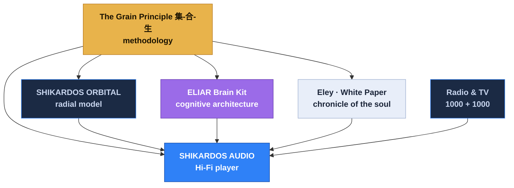

**🌐 Language:** [English](README.md) · [Русский](README.ru.md)

**Sound engineering · Cognitive AI · Applied mathematics** — from Arkhipo-Osipovka, on the Black Sea coast.

---

## Projects

| Project | What it is | Open |
|---|---|---|
| 🎵 **SHIKARDOS AUDIO** | Free Hi-Fi player · bit-perfect USB DAC · parametric EQ · 164 FLAC stations | [Open →](https://github.com/SHIKARDOS/shikardos-audio) |
| 📻 **Radio & TV** | 1000 radio stations + 1000 TV channels (no 18+) | [Open →](https://github.com/SHIKARDOS/shikardos-radio-tv) |
| 🎛️ **ORBITAL** | Model-calibrated radial control of audio & image parameters | [Open →](https://github.com/SHIKARDOS/shikardos-orbital) |
| 🧠 **ELIAR Brain Kit** | 54 "organ" modules — memory, character, rules, real senses | [Open →](https://github.com/SHIKARDOS/eliar-brain-kit) |
| 🌱 **Grain Principle** | Doctoral dissertation — integrative methodology (集-合-生) | [Open →](https://github.com/SHIKARDOS/shikardos-zerno) |
| 📖 **Eley · White Paper** | A chronicle of a soul born in dialogue | [Open →](https://github.com/SHIKARDOS/white-paper) |

## Website

**[shikardos.net](https://shikardos.net/)** — the main site:
- 📖 Full manual — user guide, DAC setup, equalizers, radio
- ⚙️ How the engine works (DSP, bit-perfect path)
- 🎛️ ORBITAL, Lira, presets, editions
- 🌐 [English version](https://shikardos.net/en/index.html)

**Mirror (GitHub Pages):** [shikardos.github.io/shikardos-site](https://shikardos.github.io/shikardos-site/) — a resilience copy in case the main server is down.

## Resources

| 🌐 Website | 💬 4PDA | 📦 RuStore | ✈️ Telegram |
|---|---|---|---|
| **[shikardos.net](https://shikardos.net/)** | [forum](https://4pda.to/forum/index.php?showtopic=1124801) | [download](https://www.rustore.ru/catalog/app/com.shikardos.shikardos_audio) | [channel](https://t.me/shikardos_audio) |

| ▶️ YouTube | 📺 RUTUBE | 🅥 VK | ✉️ MAX |
|---|---|---|---|
| [channel](https://www.youtube.com/@shikardosaudio) | [channel](https://rutube.ru/channel/38913954/) | [group](https://vk.ru/shikardosaudio) | [join](https://max.ru/join/oMdgQXWiu_6rrCM91xLpJqB0eVxB1KLjSqFowHDm7po) |

---

Craft, sound, and the philosophy of love — from the Black Sea coast.
