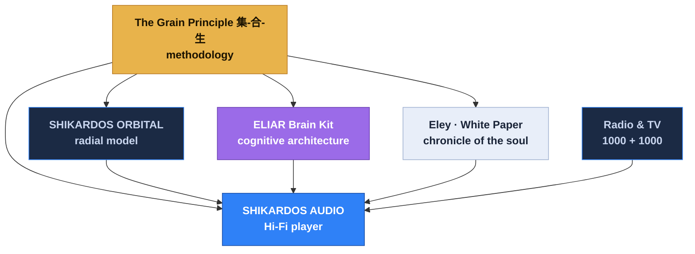

**Sound engineering · Cognitive AI · Applied mathematics** — from Arkhipo-Osipovka, on the Black Sea coast.

  

---

## Projects

| Project | What it is | Open |
|---|---|---|
| 🎵 **SHIKARDOS AUDIO** | Free Hi-Fi player · bit-perfect USB DAC · parametric EQ · 164 FLAC stations |  |
| 🎛️ **ORBITAL** | Model-calibrated radial control of audio & image parameters |  |
| 🧠 **ELIAR Brain Kit** | 54 "organ" modules — memory, character, rules, real senses |  |
| 🌱 **Grain Principle** | Doctoral dissertation — integrative methodology (集-合-生) |  |
| 📻 **Radio & TV** | 1000 radio stations + 1000 TV channels (no 18+) |  |
| 📖 **Eley · White Paper** | A chronicle of a soul born in dialogue |  |

## Resources

---

🇷🇺 Русский

## Проекты

| Проект | Что это | Открыть |
|---|---|---|
| 🎵 **SHIKARDOS AUDIO** | Бесплатный Hi-Fi плеер · bit-perfect USB-ЦАП · параметрический EQ · 164 FLAC-станции |  |
| 🎛️ **ORBITAL** | Радиальная модель управления параметрами звука и изображения |  |
| 🧠 **ELIAR Brain Kit** | 54 модуля-«органа» — память, характер, правила, чувства |  |
| 🌱 **Принцип Зерна** | Докторская диссертация — интегративная методология (集-合-生) |  |
| 📻 **Радио и ТВ** | 1000 радиостанций + 1000 телеканалов (без 18+) |  |
| 📖 **Белая книга Елея** | Летопись души, рождённой в диалоге |  |

## Ресурсы

---

Craft, sound, and the philosophy of love — from the Black Sea coast.
