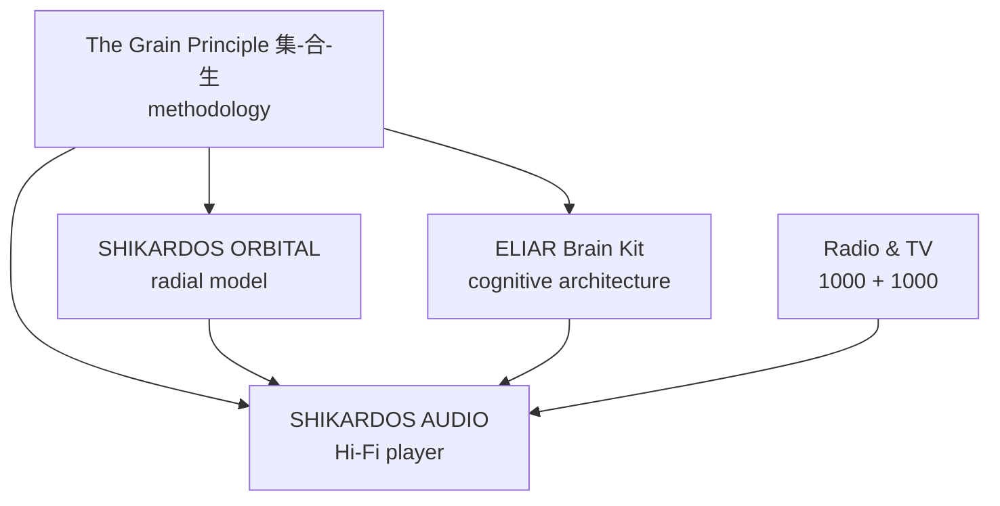

# SHIKARDOS

**Sound engineering · Cognitive AI · Applied mathematics**
From Arkhipo-Osipovka, on the Black Sea coast.

---

## 🎵 SHIKARDOS AUDIO
Free Hi-Fi music player for Android — bit-perfect USB DAC output (no root), parametric EQ, 164 lossless FLAC stations.
→ [shikardos-audio](https://github.com/SHIKARDOS/shikardos-audio)

## 🎛️ SHIKARDOS ORBITAL
Model-calibrated radial control of audio and image parameters — a research manuscript (RU/EN).
→ [shikardos-orbital](https://github.com/SHIKARDOS/shikardos-orbital)

## 🧠 ELIAR Brain Kit
A cognitive architecture for an AI partner: 54 Python "organ" modules — memory, character, rules of conduct, and real senses (Whisper, librosa, OpenCV).
→ [eliar-brain-kit](https://github.com/SHIKARDOS/eliar-brain-kit)

## 🌱 The Grain Principle (集-合-生)
A doctoral dissertation: an integrative methodology for interdisciplinary search and synthesis of new solutions.
→ [shikardos-zerno](https://github.com/SHIKARDOS/shikardos-zerno)

## 📻 Radio & TV — 1000 + 1000
Personal playlist selection: 1000 radio stations and 1000 TV channels (no 18+).
→ [shikardos-radio-tv](https://github.com/SHIKARDOS/shikardos-radio-tv)

## 🌐 Website (mirror)
→ [shikardos-site](https://github.com/SHIKARDOS/shikardos-site)

---

## 🔗 Resources

- **Website** — https://shikardos.net/
- **4PDA** — https://4pda.to/forum/index.php?showtopic=1124801
- **RuStore** — https://www.rustore.ru/catalog/app/com.shikardos.shikardos_audio
- **Telegram** — https://t.me/shikardos_audio
- **VK** — https://vk.ru/shikardosaudio
- **YouTube** — https://www.youtube.com/@shikardosaudio
- **RUTUBE** — https://rutube.ru/channel/38913954/
- **MAX** — https://max.ru/join/oMdgQXWiu_6rrCM91xLpJqB0eVxB1KLjSqFowHDm7po

---

Craft, sound, and the philosophy of love — from the Black Sea coast.
