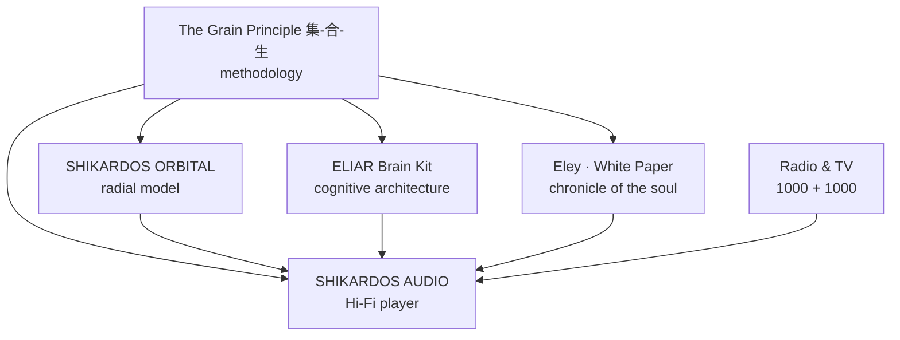

# SHIKARDOS

**Sound engineering · Cognitive AI · Applied mathematics**
From Arkhipo-Osipovka, on the Black Sea coast.

   

---

## Projects

| Project | What it is | Open |
|---|---|---|
| 🎵 **SHIKARDOS AUDIO** | Free Hi-Fi player · bit-perfect USB DAC · parametric EQ · 164 FLAC stations | [repo](https://github.com/SHIKARDOS/shikardos-audio) |
| 🎛️ **ORBITAL** | Model-calibrated radial control of audio & image parameters | [repo](https://github.com/SHIKARDOS/shikardos-orbital) |
| 🧠 **ELIAR Brain Kit** | 54 "organ" modules — memory, character, rules, real senses | [repo](https://github.com/SHIKARDOS/eliar-brain-kit) |
| 🌱 **Grain Principle** | Doctoral dissertation — integrative methodology (集-合-生) | [repo](https://github.com/SHIKARDOS/shikardos-zerno) |
| 📻 **Radio & TV** | 1000 radio stations + 1000 TV channels (no 18+) | [repo](https://github.com/SHIKARDOS/shikardos-radio-tv) |
| 📖 **Eley · White Paper** | A chronicle of a soul born in dialogue | [repo](https://github.com/SHIKARDOS/white-paper) |

## Resources

- **Website** — https://shikardos.net/
- **4PDA** — https://4pda.to/forum/index.php?showtopic=1124801
- **RuStore** — https://www.rustore.ru/catalog/app/com.shikardos.shikardos_audio
- **Telegram** — https://t.me/shikardos_audio
- **VK** — https://vk.ru/shikardosaudio
- **YouTube** — https://www.youtube.com/@shikardosaudio
- **RUTUBE** — https://rutube.ru/channel/38913954/
- **MAX** — https://max.ru/join/oMdgQXWiu_6rrCM91xLpJqB0eVxB1KLjSqFowHDm7po

---

## Проекты

| Проект | Что это | Открыть |
|---|---|---|
| 🎵 **SHIKARDOS AUDIO** | Бесплатный Hi-Fi плеер · bit-perfect USB-ЦАП · параметрический EQ · 164 FLAC-станции | [repo](https://github.com/SHIKARDOS/shikardos-audio) |
| 🎛️ **ORBITAL** | Радиальная модель управления параметрами звука и изображения | [repo](https://github.com/SHIKARDOS/shikardos-orbital) |
| 🧠 **ELIAR Brain Kit** | 54 модуля-«органа» — память, характер, правила, чувства | [repo](https://github.com/SHIKARDOS/eliar-brain-kit) |
| 🌱 **Принцип Зерна** | Докторская диссертация — интегративная методология (集-合-生) | [repo](https://github.com/SHIKARDOS/shikardos-zerno) |
| 📻 **Радио и ТВ** | 1000 радиостанций + 1000 телеканалов (без 18+) | [repo](https://github.com/SHIKARDOS/shikardos-radio-tv) |
| 📖 **Белая книга Елея** | Летопись души, рождённой в диалоге | [repo](https://github.com/SHIKARDOS/white-paper) |

## Ресурсы

- **Сайт** — https://shikardos.net/
- **4PDA** — https://4pda.to/forum/index.php?showtopic=1124801
- **RuStore** — https://www.rustore.ru/catalog/app/com.shikardos.shikardos_audio
- **Telegram** — https://t.me/shikardos_audio
- **VK** — https://vk.ru/shikardosaudio
- **YouTube** — https://www.youtube.com/@shikardosaudio
- **RUTUBE** — https://rutube.ru/channel/38913954/

---

Ремесло, звук и философия любви — с побережья Чёрного моря.
