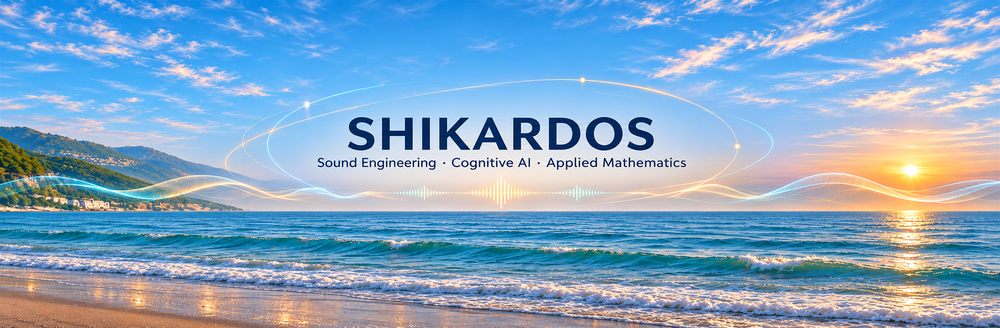
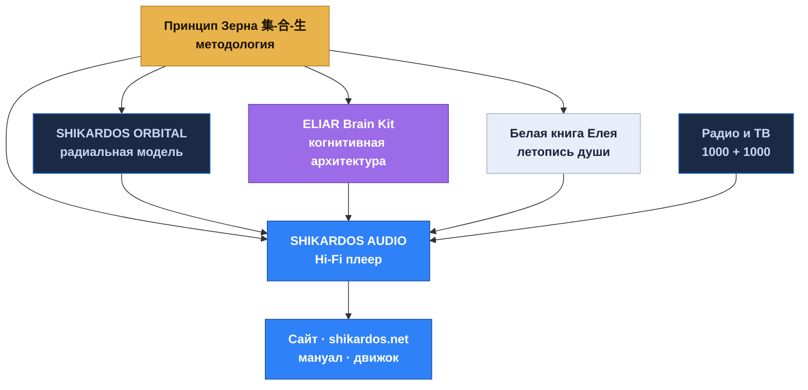

**🌐 Язык:** [English](README.md) · [Русский](README.ru.md)

**Звукоинженерия · Когнитивный ИИ · Прикладная математика** — из Архипо-Осиповки, на берегу Чёрного моря.

---

## Проекты

| Проект | Что это | Открыть |
|---|---|---|
| 🌐 **Сайт** | shikardos.net — мануал, движок, ORBITAL, Лира | [Открыть →](https://shikardos.net/) |
| 🎵 **SHIKARDOS AUDIO** | Бесплатный Hi-Fi плеер · bit-perfect USB-ЦАП · параметрический EQ · 164 FLAC-станции | [Открыть →](https://github.com/SHIKARDOS/shikardos-audio) |
| 📻 **Радио и ТВ** | 1000 радиостанций + 1000 телеканалов (без 18+) | [Открыть →](https://github.com/SHIKARDOS/shikardos-radio-tv) |
| 🎛️ **ORBITAL** | Радиальная модель управления параметрами звука и изображения | [Открыть →](https://github.com/SHIKARDOS/shikardos-orbital) |
| 🧠 **ELIAR Brain Kit** | 54 модуля-«органа» — память, характер, правила, чувства | [Открыть →](https://github.com/SHIKARDOS/eliar-brain-kit) |
| 🌱 **Принцип Зерна** | Докторская диссертация — интегративная методология (集-合-生) | [Открыть →](https://github.com/SHIKARDOS/shikardos-zerno) |
| 📖 **Белая книга Елея** | Летопись души, рождённой в диалоге | [Открыть →](https://github.com/SHIKARDOS/white-paper) |

## Сайт

**[shikardos.net](https://shikardos.net/)** — главный сайт:
- 📖 Полное руководство — мануал, настройка ЦАП, эквалайзеры, радио
- ⚙️ Как устроен движок (DSP, bit-perfect тракт)
- 🎛️ ORBITAL, Лира, пресеты, Edition
- 🌐 [Английская версия](https://shikardos.net/en/index.html)

**Зеркало (GitHub Pages):** [shikardos.github.io/shikardos-site](https://shikardos.github.io/shikardos-site/) — резервная копия, если основной сервер недоступен.

## Ресурсы

| 🌐 Сайт | 💬 4PDA | 📦 RuStore | ✈️ Telegram |
|---|---|---|---|
| **[shikardos.net](https://shikardos.net/)** | [форум](https://4pda.to/forum/index.php?showtopic=1124801) | [скачать](https://www.rustore.ru/catalog/app/com.shikardos.shikardos_audio) | [канал](https://t.me/shikardos_audio) |

| ▶️ YouTube | 📺 RUTUBE | 🅥 VK | ✉️ MAX |
|---|---|---|---|
| [канал](https://www.youtube.com/@shikardosaudio) | [канал](https://rutube.ru/channel/38913954/) | [группа](https://vk.ru/shikardosaudio) | [присоединиться](https://max.ru/join/oMdgQXWiu_6rrCM91xLpJqB0eVxB1KLjSqFowHDm7po) |

---

Ремесло, звук и философия любви — с побережья Чёрного моря.
